# Markdown Easy Visual Editor

Markdown Easy Visual Editor is a VS Code extension for writing Markdown and Textile with a live visual preview. Your document remains in its source format, so you can edit it directly while reviewing the rendered result beside it.

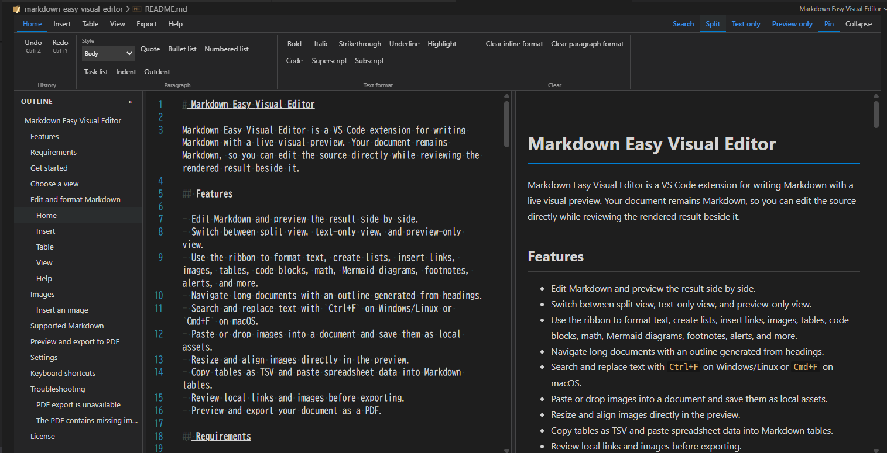

## Features

- Edit Markdown and preview the result side by side.
- Open `.textile` documents in the visual editor, and use Textile syntax alongside Markdown in Markdown documents.
- Switch between split view, text-only view, and preview-only view.
- Use the ribbon to format text, create lists, insert links, images, tables, code blocks, math, Mermaid diagrams, footnotes, alerts, and more.
- Convert the whole document between Textile and Markdown from the **Convert** tab, and convert it back; the preview stays the same.
- Navigate long documents with an outline generated from headings.
- Search and replace text with `Ctrl+F` on Windows/Linux or `Cmd+F` on macOS.
- Complete link paths and heading anchors while typing Markdown links.
- Update relative links automatically when files or folders are moved or renamed in VS Code.
- Paste or drop images into a document and save them as local assets.
- Resize and align images directly in the preview.
- Insert draw.io diagrams and open them in the draw.io editor with one click from the preview.
- Copy tables as TSV and paste spreadsheet data into Markdown tables.
- Edit Markdown tables in a spreadsheet-like table editor, including direct cell editing, row and column operations, column-width and row-height adjustment, and moving or resizing the editor.
- Review local links and images before exporting.
- Preview and export your document as a PDF.
- Export your document as HTML, with options for images and linked Markdown files.
- Export your document as an editable Word document (DOCX) with native equations.
- Right-click selected source text to attach its file range to the Copilot Chat view.

## Requirements

- Visual Studio Code 1.106 or later.
- A local, saved Markdown document for image insertion.
- A trusted VS Code workspace for PDF, HTML, and DOCX export.

## Get started

1. Open a folder containing a `.md` or `.markdown` file in VS Code.
2. Open the Markdown file.
3. If it opens as a regular text editor, right-click the file and choose **Open With > Markdown Easy Visual Editor**. You can also run **Markdown Easy Visual Editor: Open in visual editor** from the Command Palette.
4. Edit the document in the text pane and review the result in the preview pane.
5. Save the document with `Ctrl+S` (`Cmd+S` on macOS).

## Choose a view

The view buttons at the top of the editor provide three layouts:

- **Split**: show the Markdown source and preview together.
- **Text only**: focus on the Markdown source.
- **Preview only**: read the rendered document without the editing pane.

Use the **View** tab's **Outline** button to show or hide the heading outline. Select a heading in the outline to jump to that section. Use **Ctrl+wheel** or **Cmd+wheel** to zoom the editor and preview.

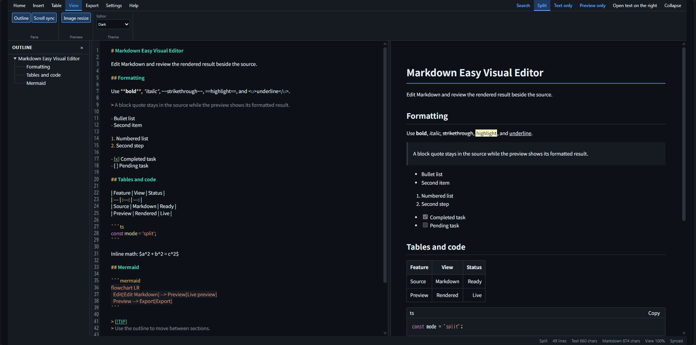

Right-click an outline item or a heading in the split Markdown preview, then choose **Copy link to section** for a same-document link or **Copy section link from this workspace folder** for a link usable from other Markdown files in that folder. The workspace link uses a folder-rooted path (for example, `[Heading](/guides/setup.md#setup "MVE workspace-root link")`); the title marks the path for this extension and is hidden in its preview. A stationary right-click opens this menu; right-click and drag on an outline item still reorders its section.

The ribbon can be collapsed when you need more space for your document.

### Reorder sections from the outline

Right-click and drag an outline item to reorder the corresponding Markdown section. The dragged heading and all of its descendants move together. A drop position is shown before or after the target heading.

The heading level must not change during a move:

- A parent can be moved to another parent at the same heading level, together with all of its children.
- A child can be moved to another parent when it remains at the same heading level. Its descendants move with it.
- A child can be dropped on a parent with no child headings. It becomes the first child of that parent without changing its heading level.
- Moves between different heading levels, such as moving a `#` heading onto a `##` heading, are not allowed.

For example, moving `# A` after `# B` carries the entire `# A` section:

```text
Before:                 After:
# A                     # B
## A-1                  ## B-1
# B                     # A
## B-1                  ## A-1
```

Moving `## A-1` after `## B-1` changes its parent while keeping it a level-2 heading:

```text
Before:                 After:
# A                     # A
## A-1                  # B
# B                     ## B-1
## B-1                  ## A-1
```

Undo and redo can be used after a successful outline move. Left-clicking an outline item continues to navigate to that heading.

## Edit and format Markdown

The ribbon is organized into tabs so common actions are easy to find.

### Home

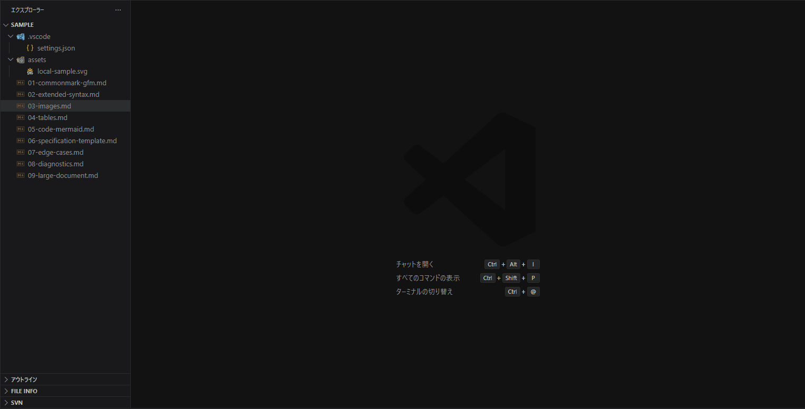

Apply headings, quotes, bullet lists, numbered lists, task lists, indentation, and text formatting such as bold, italic, strikethrough, underline, highlight, inline code, superscript, and subscript.

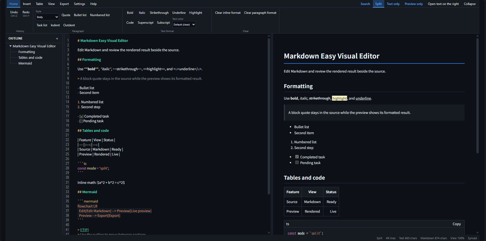

### Insert

Insert links, images, tables, horizontal rules, line breaks, blank lines (`<br>`), code blocks, mathematical expressions, footnotes, tables of contents, page breaks, callouts, and emoji. When inserting a code block, choose its language to enable syntax highlighting.

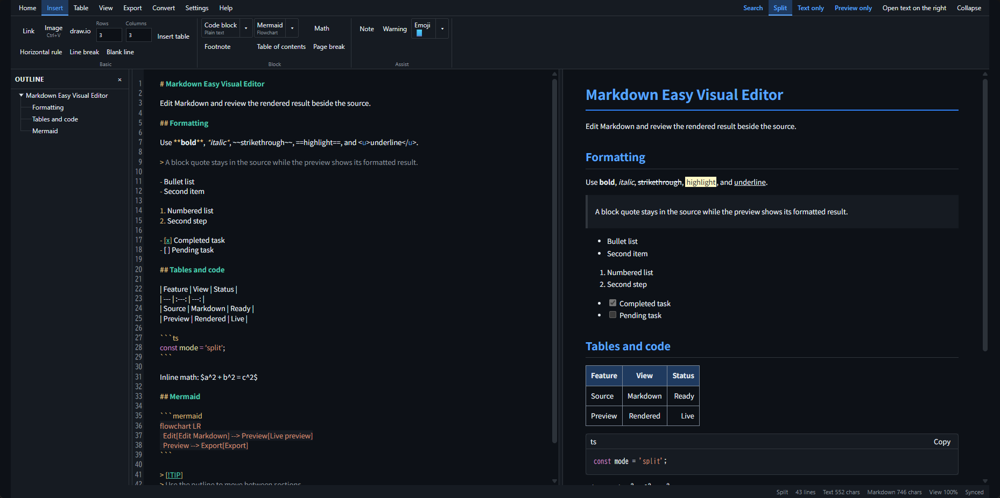

### Table

Place the cursor inside a Markdown table to:

- Open the table editor and edit cells directly.
- Add or delete rows and columns.
- Copy rows and columns, and drag row and column headers to reorder them.
- Toggle the header row.
- Align cells left, center, or right.
- Click column boundaries to auto-fit column widths to their contents, or drag them for manual adjustment. Click row boundaries to auto-fit row heights, or drag them for manual adjustment.
- Drag the title bar to move the table editor or the bottom-right corner to resize it.
- Set a header name when adding a column.
- Copy the table as tab-separated values with **Copy as TSV**.

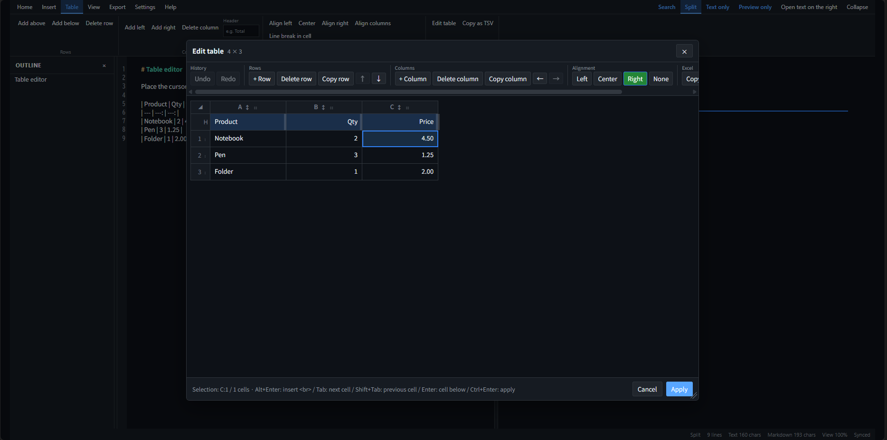

To bring spreadsheet data into Markdown, copy the cells and paste them into the editor. The data is inserted as a Markdown table or added to the table at the cursor position.

Press `Alt+Enter` inside a table cell to insert a line break in that cell.

### View

Open the same Markdown document as a regular text editor beside the visual editor, toggle the outline, and adjust the viewing layout.

### Convert

Rewrite the whole document between Textile and Markdown with **To Markdown** or **To Textile**. The editor switches its rendering to the target syntax at the same time, so the preview shows the same content. The change is a single edit, so **Undo** restores both the text and the previous rendering.

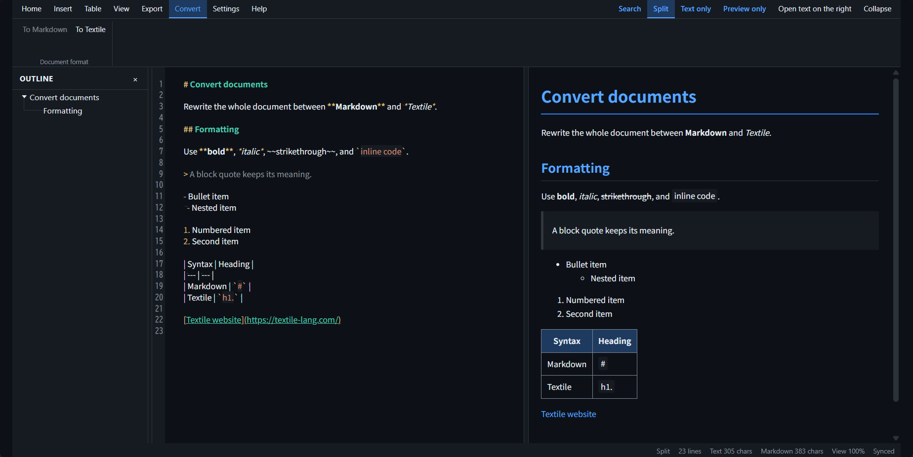

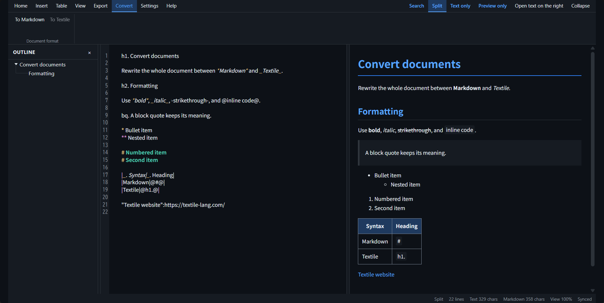

Headings, paragraphs, line breaks, quotes, code blocks, lists, tables, links, images, footnotes, and inline formatting are converted to the target syntax with the same meaning. The conversion never writes HTML. Elements that the target syntax cannot draw keep their meaning in plain syntax: Mermaid diagrams and display math become code blocks with the language `mermaid` or `math`, inline math and task-list marks stay as text, and front matter becomes a Textile comment (`###.`). Textile-only syntax, such as classes, alignment, abbreviations, and definition lists, stays as Textile in the Markdown document, because the Markdown preview also renders it. HTML that was already in the document stays as it is. The two previews can differ in small ways, such as the language label and **Copy** button on Markdown code blocks, the position of footnotes, and checkboxes or rendered diagrams that appear only in the Markdown preview.

The editor renders the document before and after the conversion and compares the content to catch conversion mistakes, and always applies the conversion. Some structures have no equivalent in Textile, such as nested quotes, a list inside a quote, or a code block inside a list item; these are written in the closest form and a message shows the line where the preview may change. Marp slide decks are converted too, and the regular preview is shown instead of slides.

Converting back applies the reverse of the conversion rules, so a round trip keeps the same preview and returns documents written in the standard form unchanged. Equivalent spellings are written in one standard form: for example, `__bold__` becomes `**bold**`, reference links become inline links, footnote labels become numbers, line breaks inside a paragraph are joined, and a hard line break is written with two trailing spaces.

The file name and extension are not changed. The editor remembers the converted format for each file in the workspace, so the file is shown in that format when it is opened again. In another workspace, the file is shown in the format of its extension.

### Help

Open **Shortcuts** for the built-in keyboard shortcut list, or open **Features** for a quick overview of the available editing tools.

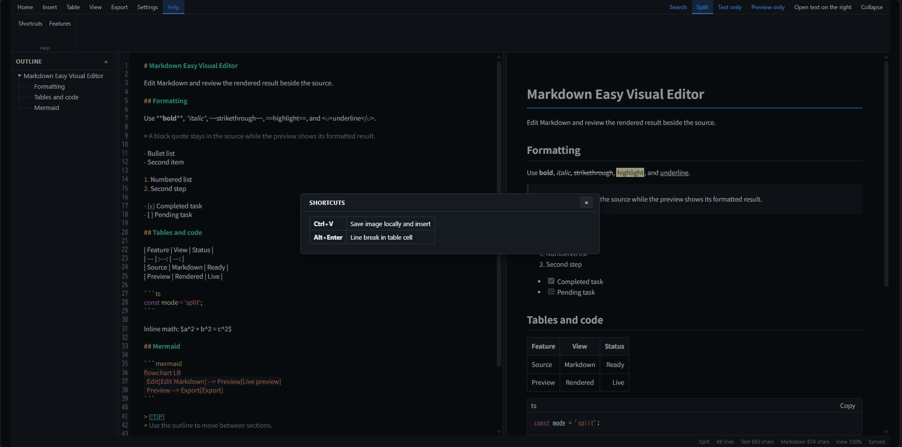

## Links

### Complete link paths and headings

While typing a link destination in the source editor, suggestions appear automatically. Press `Ctrl+Space` to show them again.

- After `](`, `[id]: `, or an HTML `src="` / `href="`, choose a file from the document's workspace folder. The path is inserted relative to the current document, with spaces and parentheses encoded.
- After `#`, choose a heading. `[text](#` lists headings in the current document, and `[text](guide.md#` lists headings in `guide.md`. Anchors use the same IDs as the preview and **Copy link to section**.

Suggestions are not shown inside code or in `.textile` documents.

### Update links when files move

When you move or rename a file or folder in VS Code (for example, in the Explorer), the extension finds Markdown files with relative links to it and asks whether to update them. Choose **Update** for this move, **Always update** to stop asking, or **Don't update** to turn the feature off. You can change this later with **Markdown Easy Visual Editor: Links: Update On File Move**.

- Links in the moved Markdown file itself are also updated so they keep pointing to the same targets.
- Moves made while the question is still open are included when you answer, so the number of files in the question is an estimate. Until you answer (or dismiss) it, later moves wait.
- `#heading` and `?query` parts, `./` prefixes, and link titles are kept. Links inside code, URLs, and absolute paths are not changed.
- The changes are applied as a refactoring, so they can be undone with **Undo**. Whether the changed files are saved follows VS Code's **Files: Refactoring Auto Save** setting.
- This works after VS Code finishes starting, even if no file is open in the visual editor. It is skipped when VS Code's built-in **Markdown: Update Links On File Move** setting is enabled, so links are not edited twice.

## Images

### Insert an image

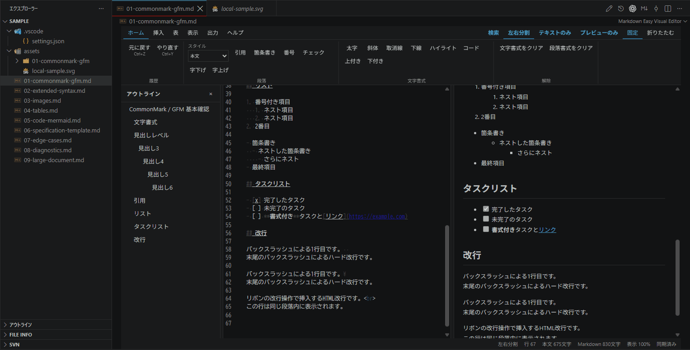

Save the Markdown document first, then use any of these methods while the source editor is editable:

- Paste an image with `Ctrl+V` or `Cmd+V`.
- Drag an image file into the editor.
- Choose **Insert > Image** and select an image file.

The extension inserts a relative Markdown reference into the document. A selected image that is already in the document's folder or the workspace is referenced where it is, without making a copy. Pasted and dropped images, and selected images from outside those folders, are saved locally first. By default, images are stored in:

```text
assets/<document-name>/
```

To change this rule from the editor, open the **Settings** tab and edit **Image save path rule**. The value is relative to the Markdown file; `${documentBasename}` is replaced with the document name without its extension, and `.` saves images beside the document.

When a preview is visible, select an image to inspect its alt text and reference. You can also drag its resize handle or use the alignment controls. Changes are written back to the Markdown source.

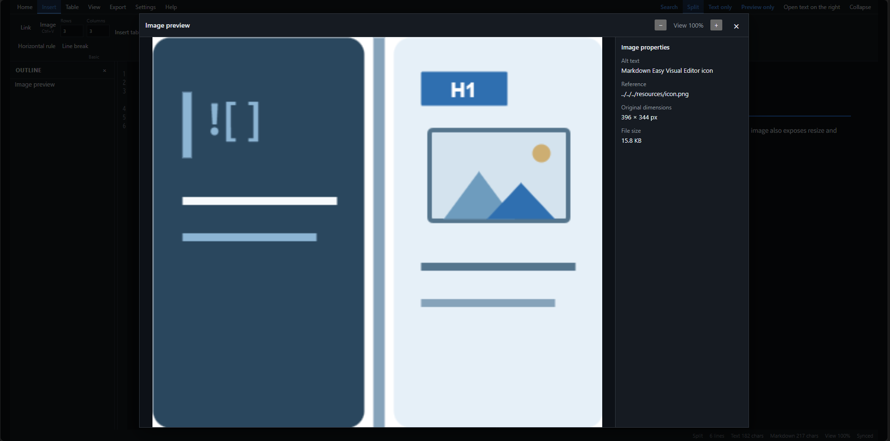

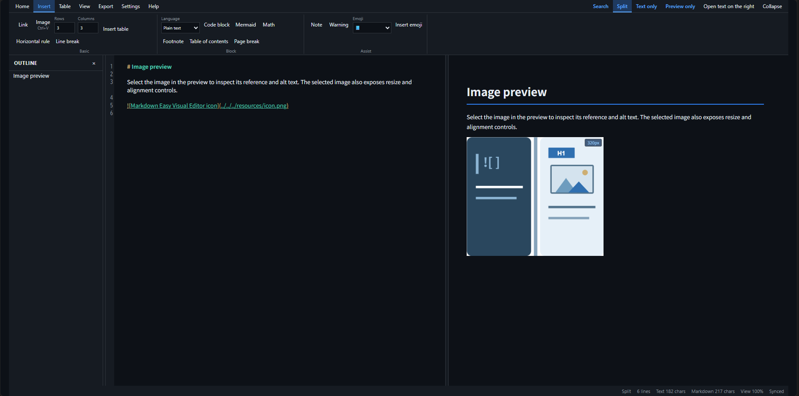

PNG, APNG, JPEG, GIF, WebP, BMP, SVG, AVIF, ICO, HEIC, HEIF, JXL, and TIFF images are supported.

Remote images can be displayed when **Markdown Easy Visual Editor: Remote Images Enabled** is enabled in VS Code settings.

### Insert and edit a draw.io diagram

Create an editable [draw.io](https://www.drawio.com/) diagram without leaving the document. Editing requires the [Draw.io Integration](https://marketplace.visualstudio.com/items?itemName=hediet.vscode-drawio) extension (`hediet.vscode-drawio`).

1. Save the Markdown document, place the cursor where the diagram should appear, and choose **Insert > draw.io**.

   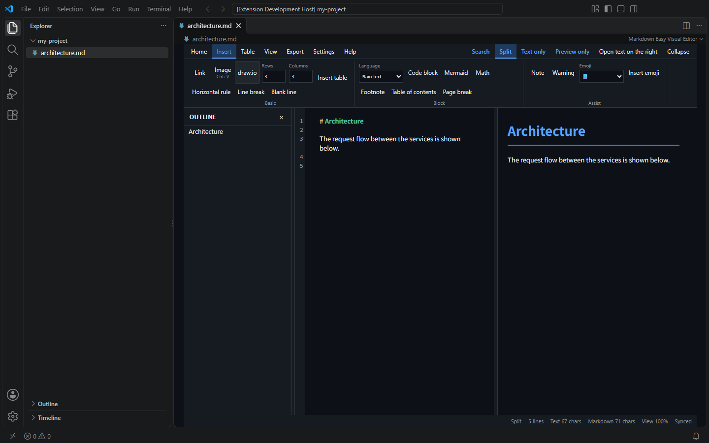

2. A small placeholder diagram is saved in the image folder (by default `assets/<document-name>/`) with a timestamped name such as `diagram-20261105-000337.drawio.svg`. An existing file with the same name is not overwritten; a sequence number such as `-2` is added instead. A linked image is inserted at the cursor, and the preview shows the diagram:

   ```markdown
   [](assets/architecture/diagram-20261105-000337.drawio.svg)
   ```

   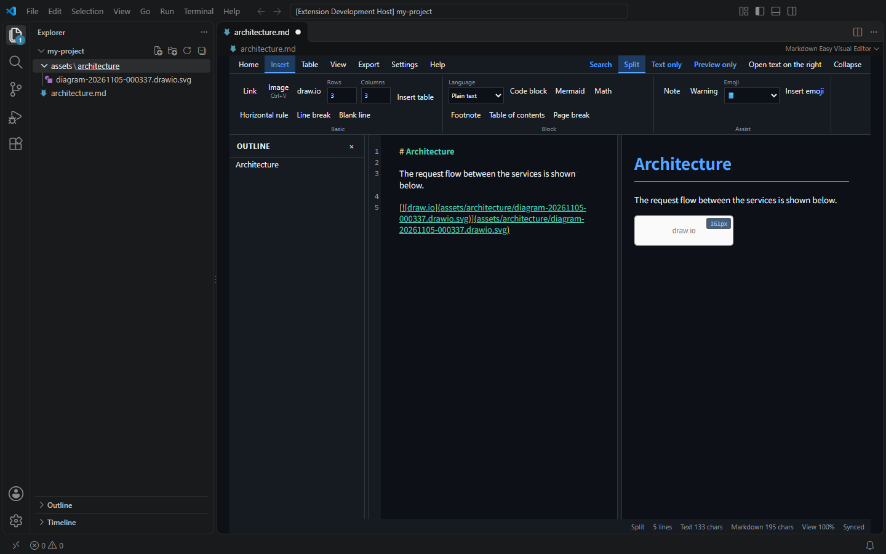

3. Click the diagram in the preview to open it in the draw.io editor. Edit and save it there; the preview updates automatically.

   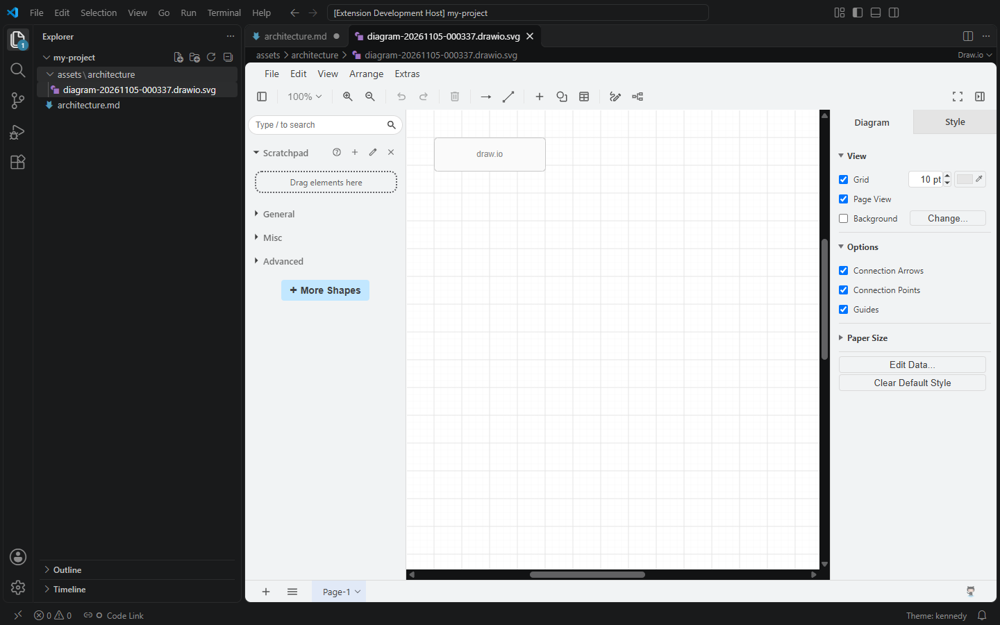

Clicking a local `.drawio.svg` or `.dio.svg` image in the preview, including Marp slide previews, opens the draw.io editor, even if the image was inserted without a link. Remote images keep the usual image preview. If the Draw.io Integration extension is not installed, the file opens in the default editor and a notification offers to show the extension.

When an SVG is saved to the image folder through **SVGとして貼り付け** (paste as SVG) in the source editor's context menu, by pasting or dropping a file, or by choosing a file that must be copied, an SVG containing draw.io diagram data is saved as `.drawio.svg`, keeping it editable in the draw.io editor. Other SVGs are saved as `.svg`. The decision uses the file content, not its name.

To jump from `.drawio.svg` to the DrawIO editor, you need to add the following settings to `settings.json`.

```json
"workbench.editorAssociations": {
  "*.drawio.svg": "hediet.vscode-drawio-text", 
  "*.dio.svg": "hediet.vscode-drawio-text"
}
```

## Supported Markdown

The renderer follows CommonMark and GitHub Flavored Markdown (GFM) conventions and supports:
Mermaid diagrams are rendered with Pele.

- Headings and heading-based outlines
- Bullet lists, numbered lists, and task lists
- Tables and table alignment
- Links and images
- Strikethrough, highlights, and underlines
- Footnotes
- Table of contents markers
- Fenced code blocks with syntax highlighting
- Mathematical expressions
- Mermaid diagrams
- Note, tip, important, warning, and caution callouts
- Page breaks

For example, a Mermaid diagram can be written as:

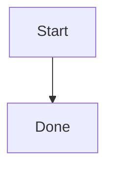


In the Markdown preview, right-click a rendered Mermaid diagram and choose **Copy as PNG** to copy the whole diagram as an image. SVG diagrams are rasterized at 3× their source dimensions, independent of preview zoom; diagrams already displayed as raster images retain their source resolution. Very large diagrams are scaled down to fit the PNG size limit.


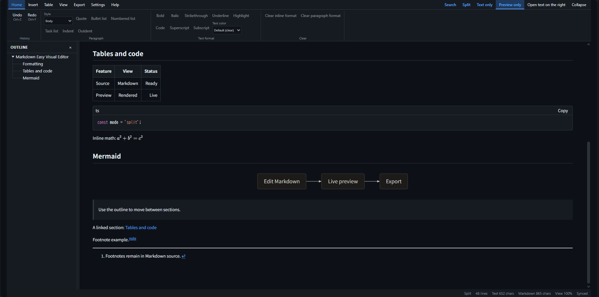

### Marp slide previews

Add `marp: true` to the YAML front matter at the start of a Markdown file to render it as a Marp slide deck automatically:

```yaml
---
marp: true
---
```

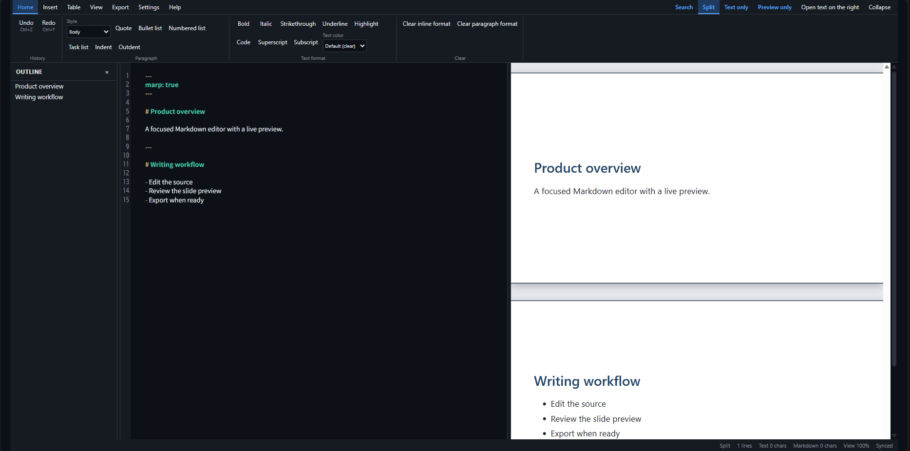

- Marp slides appear in split view, preview-only view, and print preview.
- The preview returns to the regular Markdown or PDF path when the marker is removed or set to `false`.
- The built-in `default`, `gaia`, and `uncover` themes are available. PDF and HTML exports continue to use their existing output flow.

## Supported Textile

- Open `.textile` documents in the visual editor to preview Textile formatting, lists, tables, links, images, and code. 
- Textile headings appear in the outline, nested list markers are highlighted while editing, and rendered content is included in HTML/PDF exports.
- A Textile code block with the language `mermaid` (`bc(mermaid).`) is drawn as a Mermaid diagram, as in Markdown.
- Markdown files can mix recognized Textile syntax. Markdown takes precedence where the syntaxes overlap.
- The **Convert** ribbon tab rewrites the whole document between Textile and Markdown using syntax with the same meaning.

```text
h1. Textile heading
p. A paragraph with *strong*, +inserted+, and @inline code@.
* Bullet
** Nested bullet
"Textile website":https://textile-lang.com/
```

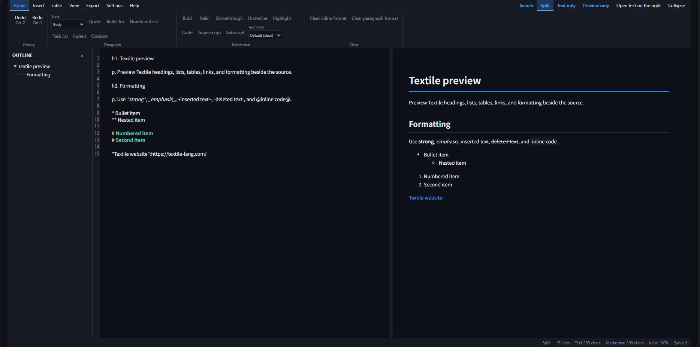

## Preview and export to PDF

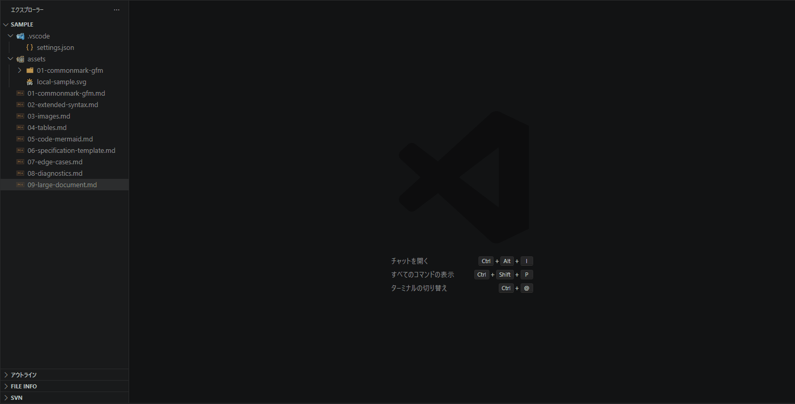

1. Open the **Export** tab.
2. Choose **Print settings** and configure the paper (A0–A6, B4, or B5), orientation, margins, header/footer, and typography.
   - Body, H1–H6, and code font sizes can be set independently.
   - Font family, line height, and paragraph spacing can also be adjusted.
   - Add any number of regular-expression rules and replacement strings to change text in PDF previews, PDF output, and HTML output without modifying the Markdown source. The same rules also apply to DOCX output.
   - Body matches can span inline formatting, but do not cross paragraph, line-break, or link boundaries.
3. Choose **Print preview** to review the result.
4. Choose **Export PDF**.
5. Leave **Export to the same folder without a dialog** enabled to save beside the Markdown file, or disable it to select the destination.

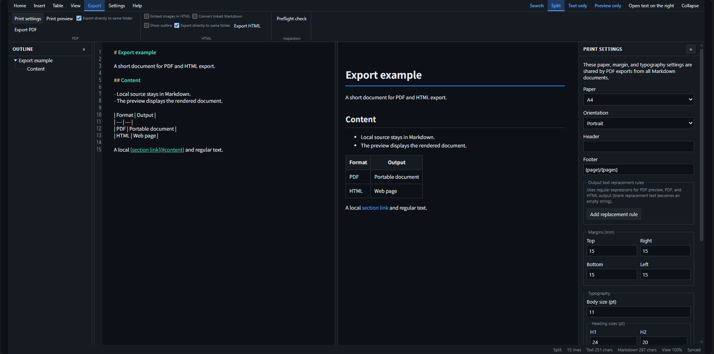

- Use **Preflight check** before exporting to review missing local images, missing local links, invalid tables, and other document issues that may affect the result.
  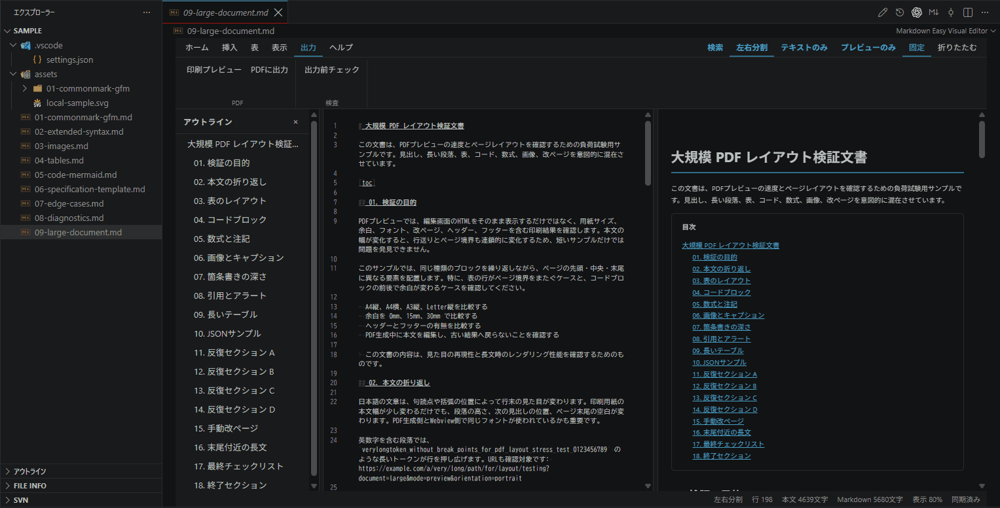

  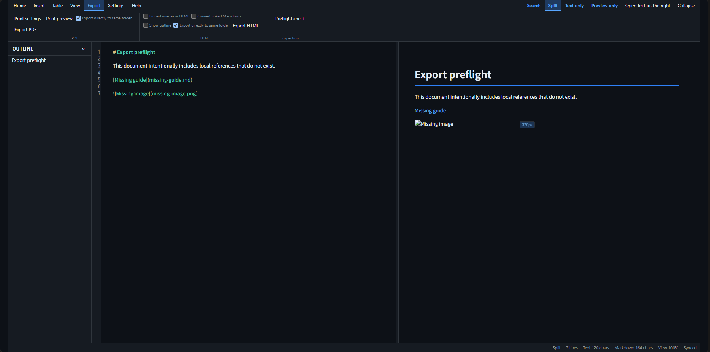
- PDF export requires a trusted workspace and Microsoft Edge or Google Chrome. The extension first tries Microsoft Edge and then Google Chrome. If neither browser is detected, set **Markdown Easy Visual Editor: PDF Browser Path** in VS Code settings to the executable path of Edge or Chrome.

## Export to HTML

The **Export** tab can convert the current Markdown document to HTML.

1. Open the **Export** tab.
2. Choose the HTML options:
   - **Embed images in HTML**: embed local images as data URLs, or leave them as relative paths when unchecked.
   - **Convert linked Markdown**: recursively convert local links to other Markdown files and update the links to their generated HTML files.
   - **Export directly to the same folder**: save the HTML beside the source Markdown file without showing a save dialog. This option is enabled by default.
3. Choose **Export HTML**.
4. Choose **Open** in the completion notification to view the generated HTML in Markdown Easy Visual Editor's HTML preview. Links between exported HTML files open in the same preview. To preview an existing HTML file, right-click it in Explorer and choose **Markdown Easy Visual Editor: Preview HTML**.

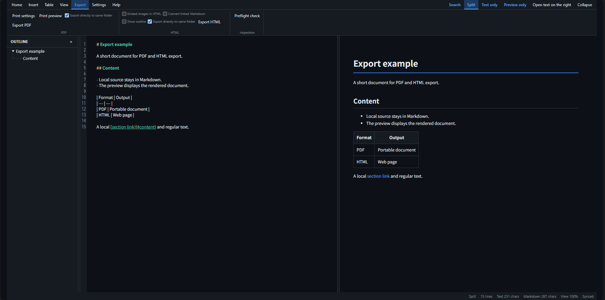

When linked Markdown conversion is enabled, each linked Markdown file is also written as an HTML file in the corresponding location. Mermaid diagrams are rendered as SVG in the generated HTML. HTML export requires a trusted workspace.

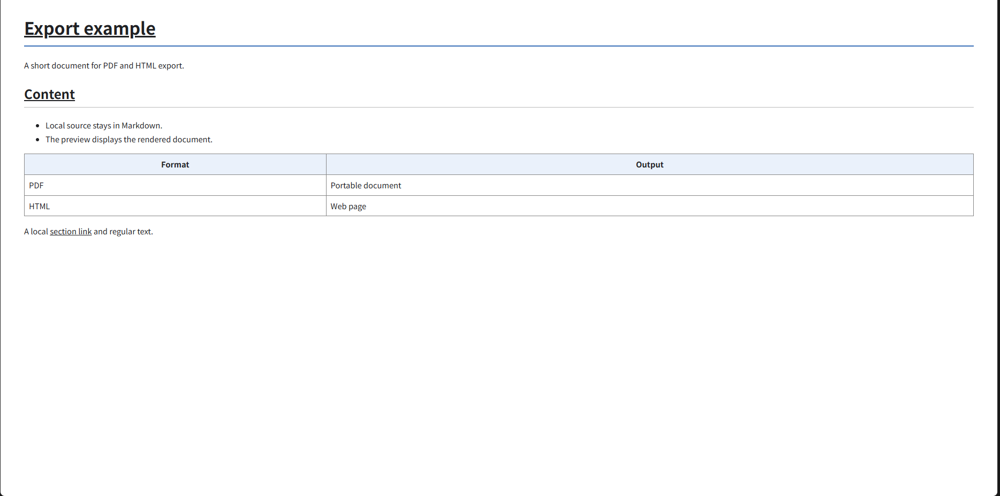

## Export to DOCX

The **DOCX** group on the **Export** tab saves the current document as an editable Word document.

1. Open the **Export** tab.
2. Set the page size, margins, fonts, header, footer, and replacement rules in **Print settings**. DOCX export uses the same print settings as PDF export.
3. Leave **Export directly to same folder** in the **DOCX** group enabled to save the DOCX beside the source Markdown file, or disable it to select the destination.
4. Choose **Export DOCX**.
5. Choose **Open** in the completion notification to open the file in the app associated with `.docx`.

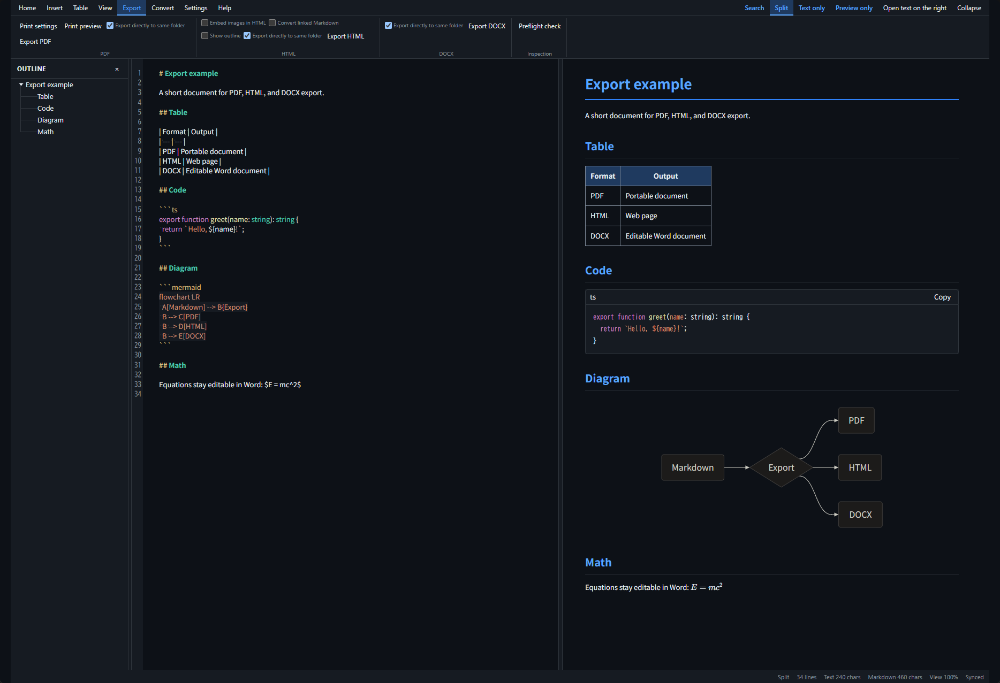

Equations become native Word equations. Marp documents are exported as regular documents, not slides. DOCX export requires a trusted workspace and Microsoft Edge or Google Chrome, like PDF export.

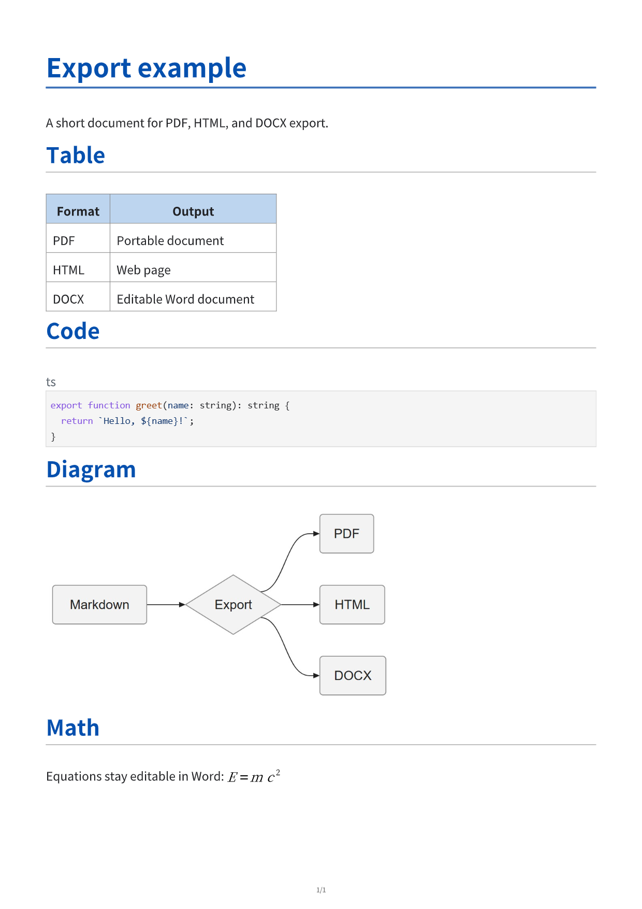

## Export from the VS Code Explorer

You can export a `.md` or `.markdown` file directly from the VS Code Explorer:

1. Right-click the Markdown file in the Explorer.
2. Select **Markdown Easy Visual Editor: Export PDF**, **Markdown Easy Visual Editor: Export HTML**, or **Markdown Easy Visual Editor: Export DOCX**.

If the file is not already open in Markdown Easy Visual Editor, the extension opens it automatically, waits for the editor and preview to initialize, and then starts the export. Explorer exports use exactly the same Markdown conversion, preview rendering, Mermaid rendering, CSS, and export pipeline as the buttons in the **Export** tab. The entry point therefore does not change the generated PDF, HTML, or DOCX output.

By default, the exported file is saved beside the source Markdown file as `<name>.pdf`, `<name>.html`, or `<name>.docx`, using the same default export options as the editor UI.

## Settings

Open the editor's **Settings** tab for image save paths, separate editor/preview fonts, and Mermaid font size. Mermaid font size is shared by the preview and HTML/PDF/DOCX exports. For all settings, open VS Code Settings and search for **Markdown Easy Visual Editor**.

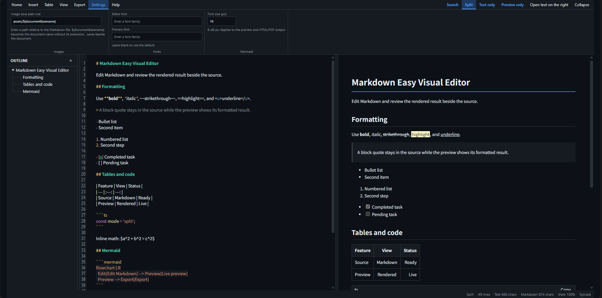

| Setting | Purpose | Default |
| --- | --- | --- |
| **Language** | Choose the editor language or follow the VS Code display language. | Auto |
| **Editor: Theme** | Choose the light or dark editor theme. | Dark |
| **Images: Directory** | Choose where locally saved images are stored. `${documentBasename}` uses the current Markdown file name. | `assets/${documentBasename}` |
| **Images: Maximum Paste Size (MB)** | Set the maximum size of each pasted image. | `100` |
| **Remote Images: Enabled** | Allow images referenced by remote URLs to appear in the preview. | Enabled |
| **Links: Update On File Move** | Ask, always, or never update relative Markdown links when files or folders are moved or renamed. | Ask |
| **Mermaid: Theme** | Choose the Mermaid preview theme. | Auto |
| **Mermaid: Font Size** | Set one font size for Mermaid diagrams in the preview and HTML/PDF/DOCX output. | `16` px |
| **PDF: Browser Path** | Specify an Edge or Chrome executable when automatic detection does not work. | Automatic detection |

## Keyboard shortcuts

| Shortcut | Action |
| --- | --- |
| `Ctrl+F` / `Cmd+F` | Open search and replace. |
| `Ctrl+V` / `Cmd+V` | Paste text, or save and insert an image when the clipboard contains one. |
| `Alt+Enter` | Insert a line break inside a table cell. |
| `Ctrl+wheel` / `Cmd+wheel` | Zoom the editor and preview. |
| `Ctrl+click` / `Cmd+click` on a link in the source editor | Open the link target, the same way as clicking it in the preview. Hover over the link to see the target. |

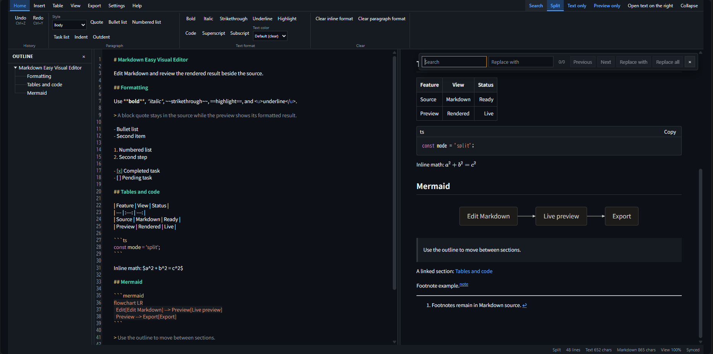

## Troubleshooting

### PDF export is unavailable

Trust the current workspace, then try **Export > Print preview** again. If Edge and Chrome cannot be found, set **PDF: Browser Path** to the executable path of either browser.

### The PDF contains missing images or links

Run **Export > Preflight check** and confirm that every relative image and link points to a file that exists next to the Markdown document.

## License

Licensed under MIT
